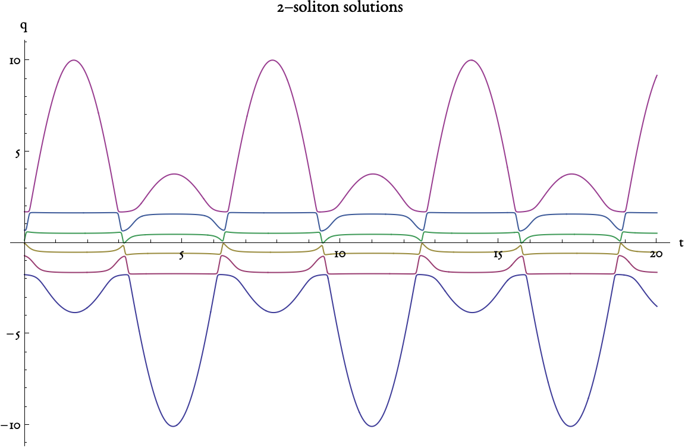

# Soliton solutions to classical Calogero-Moser systems

Thesis of Andrea Zingarofalo for the Scuola Superiore ISUFI, Università del Salento (academic year 2021/2022,
Curriculum Tecnico-Scientifico), supervised by L. Martina, together with the Mathematica notebooks used for it.

This is a learning project. It reviews the method of the references cited in the thesis and reproduces their
numerical results. It does not claim new ones.



## Abstract

The thesis reviews a general method to find M-soliton solutions to the A<sub>N−1</sub> classical Calogero-Moser
(CM) systems of rational, hyperbolic and trigonometric type, for arbitrary M < N, where N is the number of
particles, via Bäcklund transformations between systems of the same type. The method relies on a unifying
description of all these systems by a special Lax function, which generates their Lax representation. It then
studies numerically soliton solutions for the rational CM model with an external harmonic potential, for
different values of N.

## Contents

| Path | Description |
| --- | --- |
| [`AZ_ISUFI_Thesis.pdf`](AZ_ISUFI_Thesis.pdf) | The thesis (revised in 2026, see below) |
| [`AZ_ISUFI_Slides.pdf`](AZ_ISUFI_Slides.pdf) | Beamer slides of the defence (2022, not revised) |
| [`thesis/`](thesis) | LaTeX source of the thesis. The figures are drawn with pgfplots from the CSV files in `thesis/data/` |
| [`notebooks/Soliton_solutions_to_CM_systems.nb`](notebooks/Soliton_solutions_to_CM_systems.nb) | 1-soliton and 2-soliton solutions of the rational CM model with harmonic potential: Bäcklund equations solved with `FindRoot`, time evolution by the Olshanetsky-Perelomov projection method, worldline plots |
| [`notebooks/export_figure_data.wls`](notebooks/export_figure_data.wls) | Script that writes the data of Figs 3.2–3.6 of the thesis, using the definitions of the notebook above |
| [`notebooks/CM_thesis.nb`](notebooks/CM_thesis.nb) | First experiments: equilibrium equations (3.15a) for a 1-soliton with z(0) = 1 + i, solved with `NSolve` for small N |
| [`notebooks/images/`](notebooks/images) | Figures exported by the notebook |

## Building

To regenerate the figure data and build the thesis:

```bash
wolframscript -file notebooks/export_figure_data.wls thesis/data
cd thesis && latexmk -pdf main.tex
```

The notebooks were written with Wolfram Mathematica 12–13 and re-run from a fresh kernel with Mathematica 14.0.
They can also be viewed with the free [Wolfram Player](https://www.wolfram.com/player/).
`Soliton_solutions_to_CM_systems.nb` takes about 5 minutes and writes its figures to `images/` next to the
notebook. In `CM_thesis.nb`, `NSolve` takes about 5 minutes for N = 5 and many hours for N = 6.

## Changes since 2022

Thesis:

- Fixed errors in the equations. Among them:
  - the size of the symplectic matrix and the sign of the canonical bracket;
  - the harmonic oscillator Lax equations;
  - the double counting of pairs in the CM Hamiltonians;
  - the change of variables to the trigonometric and hyperbolic systems, and their Olshanetsky-Perelomov solution;
  - the dual equations ż<sub>n</sub> in the Bäcklund transformations (wrong ω term and summation limits);
  - the KdV soliton and the Benjamin-Ono normalization;
  - the electrostatic interpretation.
- Fixed references (authors, translators, years), English, and the table of contents.
- The figures are redrawn from the notebook data, with the time t on the horizontal axis. Before, the axis
  showed the sample index.
- The font is back to Computer Modern.

The slides are the 2022 version and still contain some of these errors.

Notebooks:

- `CM_thesis.nb`: the interaction sum in `sis[n]` ran over `{k, 1, 2}` instead of `{k, 1, n}`, so the results
  for N ≥ 3 were wrong. Fixed and re-run.
- `Soliton_solutions_to_CM_systems.nb`: the figure cells referred to earlier outputs through `Out[n]`, which
  only worked in the original session. They now use named variables. The plots use t on the horizontal axis,
  and the figures are exported next to the notebook instead of to an absolute local path.

## License

The code is released under the [MIT License](LICENSE).
